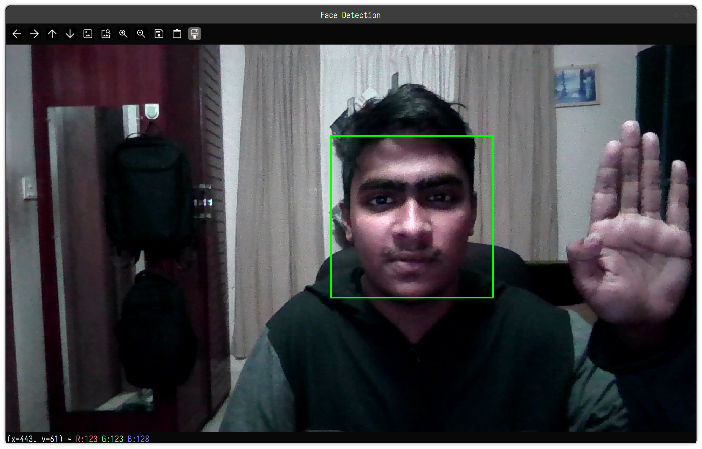

# Face-Regeneration
Leaning to use computer to see stuff
Used Opencv library.
You need to change the location of cascade file hat contains data for performing object detection, typically using the Haar Cascade algorithm in the script.

