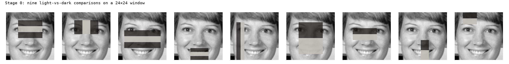
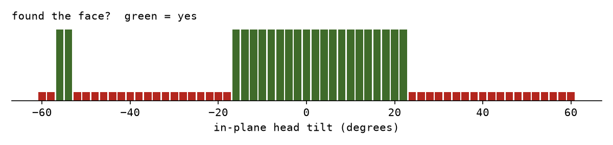
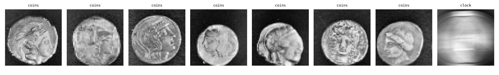

# pareidolia

**What does a 2001 face detector actually look at?**

My first computer-vision program (November 2023) opened a webcam, ran
OpenCV's Haar cascade and drew green boxes on my face. It felt like magic,
and magic is a bad place to stop. A machine that finds faces has to be
looking for *something*, so this repo opens the box.

The detector is the Viola–Jones cascade (2001) in OpenCV's
`haarcascade_frontalface_default.xml`: 25 stages and 2,913 tiny
comparisons, each one asking whether one rectangle of pixels is brighter
than the rectangle next to it.

## 1. The first nine questions

Every 24 × 24 window in the image must pass stage 0 before anything else
looks at it. Stage 0 asks nine light-versus-dark questions:



Dark band of eyes over lighter cheeks. A bright bridge of nose between two
dark eye sockets. Darker mouth line under a lighter upper lip. No eyes,
no skin, no idea what a person is: a face is whatever has its shadows in
the right places. Most windows in a photo fail within these nine questions,
which is why this ran in real time on 2001 hardware.

## 2. How far can you tilt your head?

The face is rotated in 2° steps about its own centre (flat grey padding so
the detector can't cheat on a mirrored copy). A hit only counts if it lands
on the real face at a plausible size.



Found continuously from **−16° to +22°**: a ~38° window, lopsided because the
face in the photo already leans. It comes back for two frames near −55° for
reasons the cascade does not explain. A "frontal face" detector means it:
tilt your head like a curious dog and you stop existing.

## 3. Faces in things

With the neighbour vote loosened from 5 to 3, the cascade ran over 12
images that contain no people: coffee, a rocket, gravel, grass, the Moon, the
Hubble deep field, tissue under a microscope, a page of text…



It found **9 faces**. Seven are on a tray of ancient Greek coins, which
really do carry portrait heads, so the detector is *right* and I was the one
who assumed. The other two, a motion-blurred clock face and a patch of gravel,
are true pareidolia: the brain's habit of seeing faces in sockets and clouds,
reproduced in 2,913 rectangles.

## Why this mattered to me

Every later detector I trained, on AUVs and rovers, was a deeper and more
opaque version of this one. This was the last time I could print the whole
model, read it and point at the line that made a mistake. I still
open models up before I trust them.

## Run it

```bash
python -m venv .venv && . .venv/bin/activate
pip install -r requirements.txt
python -m pareidolia.run      # ~5 s, prints findings, rewrites assets/*.png
```

No webcam, no downloads: test images ship with scikit-image.

## Layout

```
origin/Main.py        the 2023 webcam loop
cascade.xml           OpenCV's frontal-face cascade (Lienhart), with its licence header
pareidolia/run.py     feature drawing, rotation sweep, the face hunt
```
